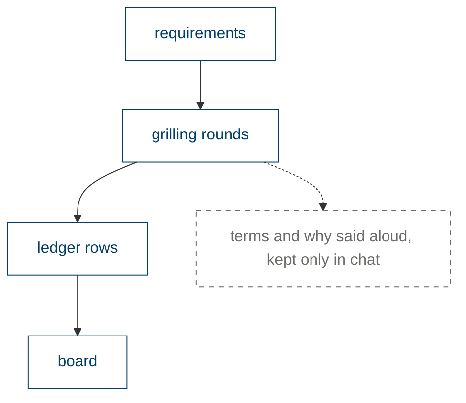
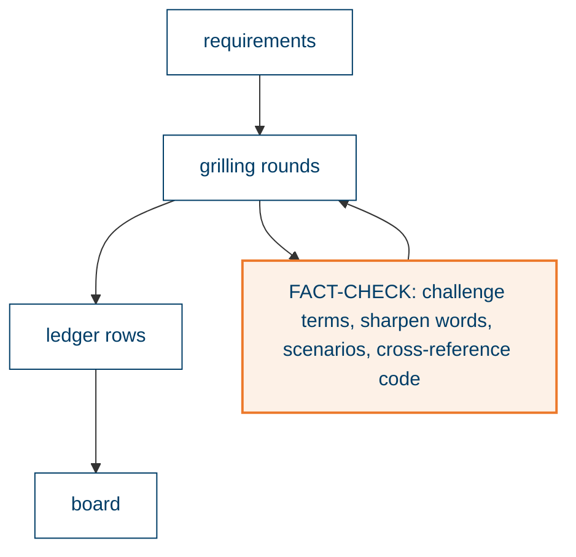
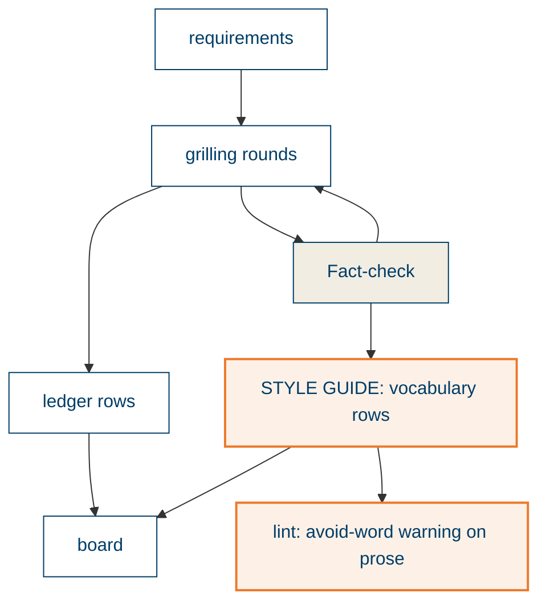
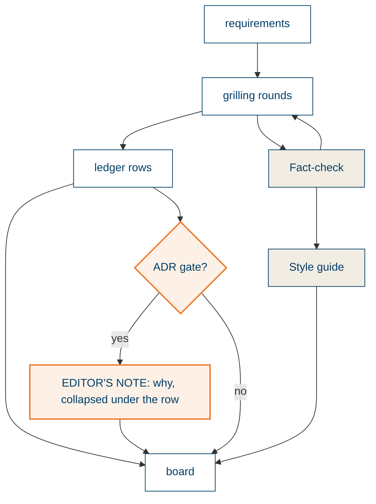
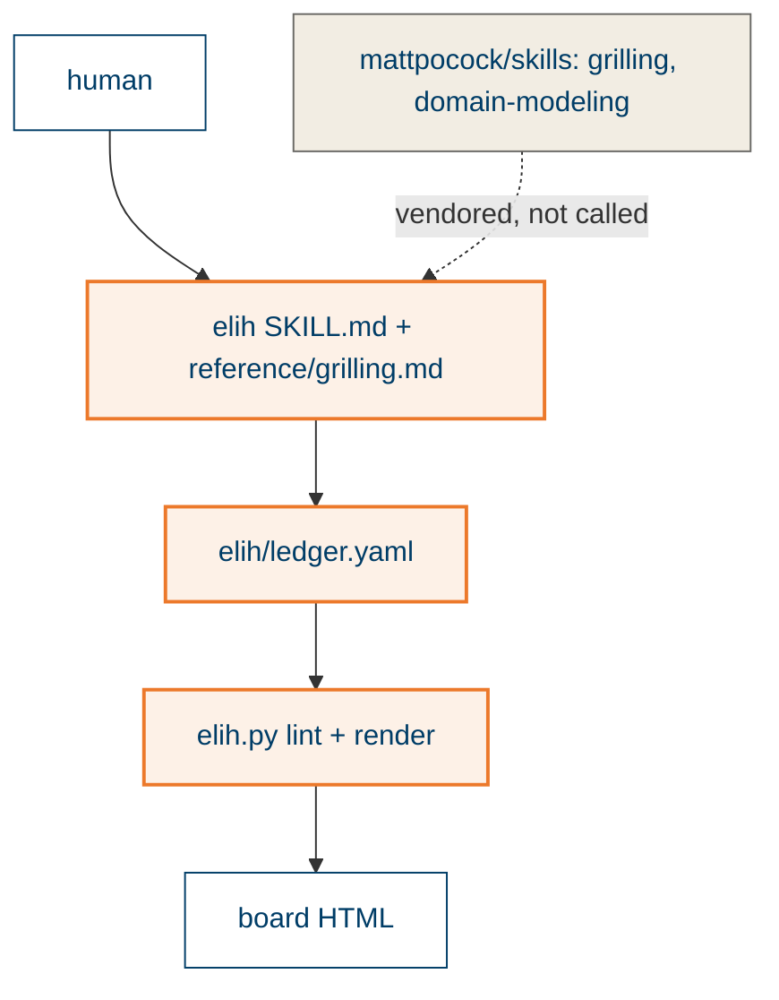

# Board

## Today's flow and what breaks

The grilling elicits vocabulary and reasons, but only decisions have a home in the ledger. Words drift between the ledger and the diagrams, and a reader of a decision row cannot see why it was made.

## Pass 1: Fact-check

## Pass 2: Style guide

## Pass 3: Editor's note

## Context: who talks to whom

