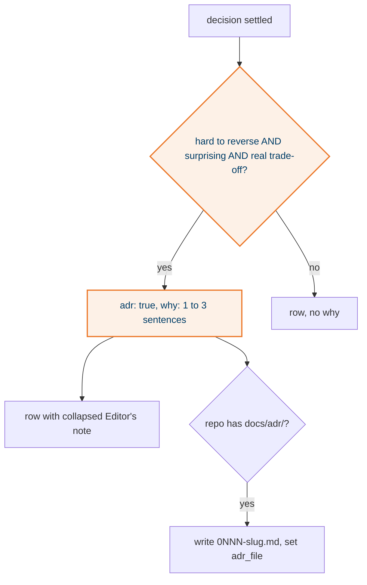

## What it does

A decision row may carry `adr: true` and a `why` of one to three sentences. The gate is Pocock's: hard to reverse, surprising without context, a real trade-off. The row's one-sentence summary is unchanged; the why shows collapsed under it on the ledger tab and on the chunk page.

## Why this way

- Why on the row, not in a file, because the ledger already plays the ADR role and a file per decision is the entity inflation elih exists to stop.
- A file only when the repo already keeps `docs/adr/`, so teams that read ADRs there keep finding them there.
- Lint enforces only `adr` implies `why`. The gate itself is judgement and stays with the agent.

## How it works

## States

None.

## Traceability

| Requirement or decision | Where | Pinned by |
|---|---|---|
| D-3 | `reference/ledger-schema.md` "Editor's notes and the style guide" | this trial's D-3 note |
| P3 | example D-31, D-32, D-36 | real reasons from the post-call threads |

## Decisions and assumptions on this chunk

Filled from the ledger by chunk id.

## Review entry points

1. `home/dot_claude/skills/elih/examples/post-call-event-gen/ledger.yaml` D-32 `why`: does it read as a reason a future engineer would need, or as a restatement?
2. `home/dot_claude/skills/elih/scripts/executable_elih.py` `why_html`: is the collapsed note discoverable enough on the board?
