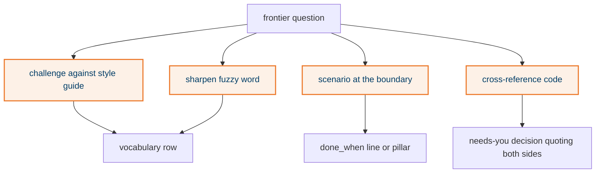

## What it does

Four disciplines run inside every grilling round: challenge a word against the style guide, sharpen a fuzzy word into one canonical term, invent a concrete scenario at a boundary, and check a claim against the repo. Each has a fixed landing place in the ledger so nothing said while grilling survives only in chat.

## Why this way

- Vendored into `reference/grilling.md` rather than invoking `domain-modeling`, because the plugin is not installed here and P2 says elih must stand alone.
- Scenarios are not recorded as rows. They sharpen the question; the sharpened answer is what lands. Recording them would be a new entity.

## How it works

## States

None.

## Traceability

| Requirement or decision | Where | Pinned by |
|---|---|---|
| D-1, D-4 | `reference/grilling.md` "Fact-check" and "Landing answers" | this trial's ledger |
| P2 | `reference/grilling.md` "Which copy runs" | plugin absent on this machine |

## Decisions and assumptions on this chunk

Filled from the ledger by chunk id.

## Review entry points

1. `home/dot_claude/skills/elih/reference/grilling.md`: are the four disciplines phrased as things to do mid-round, not as a separate step?
2. `home/dot_claude/skills/elih/SKILL.md` step A.3: does every grilling outcome have exactly one landing place?
