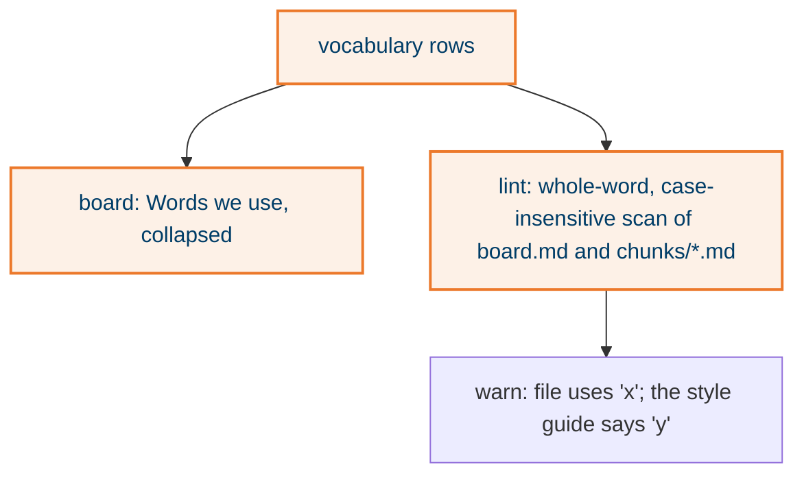

## What it does

A `vocabulary` list in the ledger holds one name per project concept, its meaning with no implementation detail, and the words to avoid. The board shows it as a collapsed "Words we use" panel below the pillars. Lint warns whenever an avoided word appears in `board.md` or a chunk page.

## Why this way

- In the ledger, not a separate file, because P1 holds and the board is the one surface the team reads.
- Warning, not error, because avoided words can be ordinary English and the agent must not be blocked by its own style guide.
- On first run against the post-call example the scan found that every diagram said "Legacy detection" while the ledger said "clerk". That is the drift it exists to catch.

## How it works

## States

None.

## Traceability

| Requirement or decision | Where | Pinned by |
|---|---|---|
| D-2, D-5, D-6 | `scripts/elih.py` lint vocabulary block and `words_panel` | example lint output |
| C-1 | example ledger, field guide avoid list | the false positive on `config-manager` |

## Decisions and assumptions on this chunk

Filled from the ledger by chunk id.

## Review entry points

1. `home/dot_claude/skills/elih/scripts/executable_elih.py` lint, the `vocab` block: is the scan too eager on short words?
2. `home/dot_claude/skills/elih/examples/post-call-event-gen/ledger.yaml` `vocabulary:`: would a non-dev teammate understand each meaning?
